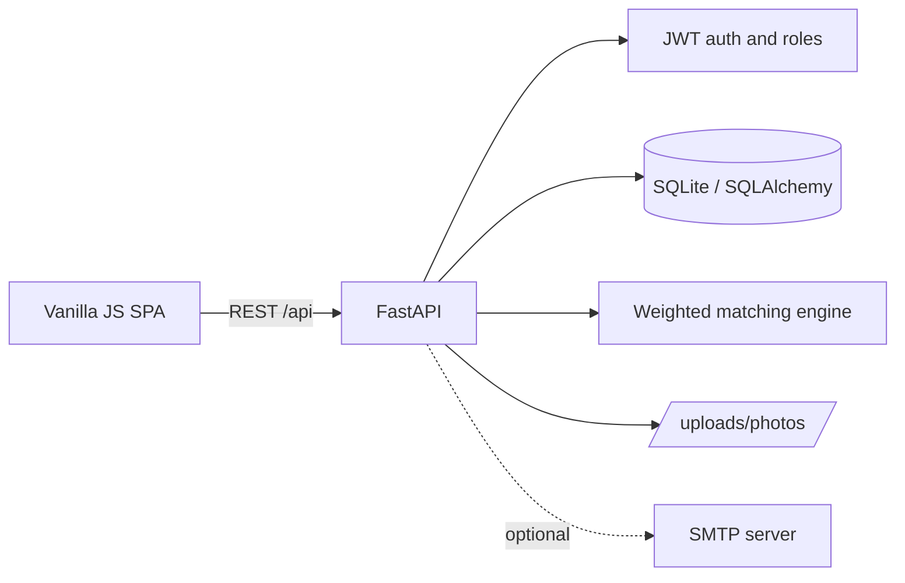

<p align="center">
  
</p>

<h1 align="center">ReUnite AI</h1>

<p align="center">
  <strong>Smart Lost &amp; Found family reunification platform.</strong><br/>
  File missing-person and found-person reports, let the matching engine surface likely connections, and keep humans in charge of verification.
</p>

<p align="center">
  
  
  
  
  
  
</p>

> [!WARNING]
> A match score is a similarity signal for human review — **it does not confirm identity**. Always verify through appropriate authorities and direct contact before acting on a match.

## Overview

ReUnite AI is a full-stack application for reuniting missing people with their families. It supports two report types:

- **Missing** — someone is searching for a person.
- **Found** — someone has located a person who may be lost.

Each report captures physical descriptors, last-seen or found location, clothing, distinguishing features, photos, and private contact details. When a report is created, the backend scores it against every active report of the opposite type and stores matches above a configurable threshold.

The frontend is a dependency-free single-page app served directly by FastAPI, so the whole product runs as one process.

## Features

- **Report management** — create, browse, search, filter, update, and delete reports; attach one or more photos.
- **Weighted matching engine** — transparent, attribute-by-attribute similarity scoring with a stored factor breakdown.
- **Match review workflow** — suggested, confirmed, and rejected states; re-run matching for any report.
- **Accounts and roles** — JWT authentication, user dashboard, admin role.
- **Admin dashboard** — platform stats, pending-report moderation, all matches, user activation and promotion.
- **Privacy-aware defaults** — contact fields are separate from public report content; public listings show active, public reports only.
- **Optional email templates** — branded SMTP helpers for match and submission notifications.
- **Multiple deployment paths** — Docker, Render, Netlify + Render split, or systemd on a VPS.
- **Security headers** — `nosniff`, `DENY` framing, referrer policy, and HSTS in production.

## How matching works

The engine in `backend/app/services/matching.py` compares a missing report against a found report (or vice versa) and produces a score between `0.0` and `1.0`.

| Factor | Weight | Method |
| --- | ---: | --- |
| Age range | 0.25 | Range overlap, with a gap penalty |
| Gender | 0.20 | Exact match unless either side is unknown |
| Height range | 0.10 | Range overlap |
| Hair color | 0.10 | Exact or partial string match |
| Eye color | 0.10 | Exact or partial string match |
| Skin tone | 0.05 | Exact or partial string match |
| Build | 0.05 | Exact or partial string match |
| Clothing description | 0.10 | Token Jaccard similarity |
| Distinguishing features | 0.05 | Token Jaccard similarity |

Unknown fields receive neutral partial credit (`0.5`) so missing data neither rewards nor punishes a candidate. Matches are created only when the weighted score reaches `MATCH_SCORE_THRESHOLD` (default `0.3`). Each stored match keeps its per-factor breakdown in `match_details` for review.

## Architecture



## Project structure

```text
.
├── backend/
│   ├── app/
│   │   ├── api/routes/       # auth, reports, matches, admin endpoints
│   │   ├── core/             # config, database, JWT/password security
│   │   ├── models/           # SQLAlchemy models
│   │   ├── schemas/          # Pydantic request/response schemas
│   │   ├── services/         # matching engine, email templates
│   │   └── main.py           # FastAPI app, middleware, static serving
│   └── pyrightconfig.json
├── frontend/
│   ├── index.html            # SPA shell and page templates
│   ├── public/assets/        # logo and static assets
│   └── src/                  # app.js and main.css
├── uploads/photos/           # uploaded report photos (runtime data)
├── seed.py                   # demo admin, user, reports, matches
├── run.py                    # development entry point
├── gunicorn.conf.py          # production server config
├── Dockerfile
├── docker-compose.yml
├── render.yaml               # Render blueprint
├── netlify.toml              # Netlify frontend + API proxy
└── reunite-ai.service        # systemd unit template
```

## Getting started

### Prerequisites

- Python 3.11+
- pip
- Docker (optional, for containerized runs)

### Local development

```bash
git clone https://github.com/Your-Voldemort/Lost-and-found.git
cd Lost-and-found

python -m venv venv
source venv/bin/activate        # Windows: venv\Scripts\activate
pip install -r requirements.txt

cp .env.example .env
```

Generate a real secret key and put it in `.env`:

```bash
python -c "import secrets; print(secrets.token_hex(32))"
```

Seed demo data (admin, demo user, sample reports, and matches):

```bash
python seed.py
```

Start the app:

```bash
python run.py
```

Open <http://localhost:8000>. API docs are available at <http://localhost:8000/api/docs> only when `DEBUG=true`.

### Docker

```bash
cp .env.example .env
docker compose up --build
```

The app is served at <http://localhost:8000>. The database and uploaded photos are persisted through bind mounts.

## Configuration

Configuration lives in `backend/app/core/config.py` and is read from environment variables or `.env`.

| Variable | Default | Description |
| --- | --- | --- |
| `DATABASE_URL` | `sqlite:///<backend>/reunite.db` | SQLAlchemy database URL. SQLite is the default. |
| `SECRET_KEY` | development placeholder | JWT signing key. **Set a strong value in production.** |
| `DEBUG` | `false` | Enables `/api/docs`, `/api/redoc`, OpenAPI, and auto-reload. |
| `APP_URL` | `http://localhost:8000` | Public URL used in email links. |
| `ALLOWED_ORIGINS` | localhost origins | Comma-separated CORS allowlist. |
| `EMAIL_ENABLED` | `false` | Enables the SMTP helper. |
| `SMTP_HOST` | `smtp.gmail.com` | SMTP server hostname. |
| `SMTP_PORT` | `587` | SMTP port; `587` enables STARTTLS. |
| `SMTP_USER` | empty | SMTP username. |
| `SMTP_PASSWORD` | empty | SMTP password or app password. |
| `SMTP_FROM_NAME` | `ReUnite AI` | Display name for outgoing mail. |
| `SMTP_FROM_EMAIL` | empty | Sender address; falls back to `SMTP_USER`. |
| `PORT` | `8000` | Server port. |
| `GUNICORN_WORKERS` | `3` | Worker count for Gunicorn. |

Uploaded photos are written to `uploads/photos/` at the project root and served at `/uploads/photos/<filename>`. Maximum file size is **5 MB**; allowed types are JPEG, PNG, WebP, and GIF.

## API reference

All routes are prefixed with `/api`. Authenticated routes expect `Authorization: Bearer <token>`.

| Method | Endpoint | Auth | Purpose |
| --- | --- | --- | --- |
| `GET` | `/health` | Public | Health and version check |
| `POST` | `/auth/register` | Public | Create an account, returns a JWT |
| `POST` | `/auth/login` | Public | OAuth2 password form (`username` = email) |
| `GET` | `/auth/me` | User | Current user profile |
| `POST` | `/reports/` | Optional | Create a report (multipart form + photos) |
| `GET` | `/reports/` | Public | Paginated public, active reports with filters |
| `GET` | `/reports/my` | User | Reports submitted by the current user |
| `GET` | `/reports/{id}` | Public | Report detail |
| `PATCH` | `/reports/{id}` | Owner/Admin | Update report fields |
| `DELETE` | `/reports/{id}` | Owner/Admin | Delete a report |
| `POST` | `/reports/{id}/photos` | Owner/Admin | Add photos to a report |
| `GET` | `/matches/` | User | Matches involving the user's reports (admins see all) |
| `GET` | `/matches/admin/all` | Admin | Paginated match list |
| `GET` | `/matches/{id}` | User | Match detail |
| `PATCH` | `/matches/{id}` | User | Set match status (suggested/confirmed/rejected) |
| `POST` | `/matches/rematch/{report_id}` | Owner/Admin | Re-run matching for one report |
| `GET` | `/admin/stats` | Admin | Platform counters |
| `GET` | `/admin/users` | Admin | Paginated user list |
| `PATCH` | `/admin/users/{id}/toggle-active` | Admin | Activate or deactivate a user |
| `PATCH` | `/admin/users/{id}/make-admin` | Admin | Promote a user |
| `GET` | `/admin/reports/pending` | Admin | Reports awaiting review |
| `GET` | `/admin/reports/all` | Admin | All reports regardless of visibility |
| `PATCH` | `/admin/reports/{id}/approve` | Admin | Approve a pending report |
| `PATCH` | `/admin/reports/{id}/close` | Admin | Close a report |
| `PATCH` | `/admin/reports/{id}/status` | Admin | Set any report status |

Report detail responses redact contact fields unless the requester owns the report or is an admin. Private reports return `404` to everyone else, and match detail/update endpoints are limited to the reports' owners and admins.

## Demo accounts

`python seed.py` creates:

| Role | Email | Password |
| --- | --- | --- |
| Admin | `admin@reunite.ai` | `admin1234` |
| Demo user | `demo@example.com` | `demo1234` |

> [!IMPORTANT]
> These credentials are for local demos only. Change or remove them before exposing the app publicly.

## Deployment

### Docker

```bash
docker compose up --build -d
```

The container runs Uvicorn with two workers and exposes port `8000`. Use a reverse proxy such as Caddy or Nginx for TLS.

### Render

`render.yaml` defines a Python web service:

- Build: `pip install -r requirements.txt`
- Start: `gunicorn -c gunicorn.conf.py backend.app.main:app`

Set `SECRET_KEY` in the Render dashboard (the blueprint generates one) and set `ALLOWED_ORIGINS` to your real frontend origin instead of `*`.

### Netlify frontend + Render backend

`netlify.toml` publishes `frontend/` and proxies `/api/*` and `/uploads/*` to a backend host. Update the hardcoded `https://lost-and-found-backend.onrender.com` targets to your own backend URL before deploying.

### systemd on a VPS

`reunite-ai.service` is a template for running Gunicorn under systemd. Adjust `WorkingDirectory`, `EnvironmentFile`, and the venv path, then:

```bash
sudo cp reunite-ai.service /etc/systemd/system/
sudo systemctl daemon-reload
sudo systemctl enable --now reunite-ai
```

## Production checklist

- [ ] Set a unique, high-entropy `SECRET_KEY`.
- [ ] Replace or remove the seeded admin and demo accounts.
- [ ] Set `DEBUG=false` so interactive docs are disabled.
- [ ] Restrict `ALLOWED_ORIGINS` to trusted origins.
- [ ] Serve over HTTPS; HSTS is enabled automatically outside debug mode.
- [ ] Back up the SQLite database and `uploads/` directory, or migrate to PostgreSQL for multi-instance deployments.
- [ ] Configure SMTP only if you intend to use the email helpers.
- [ ] Review the privacy implications of public report details and uploaded photos.

## Troubleshooting

**Interactive API docs return 404** — set `DEBUG=true` in `.env` and restart. Docs are intentionally disabled in production.

**Photos return 404** — confirm files exist in `uploads/photos/` and that the app was started from the project root so the static mounts resolve correctly.

**Login fails with valid credentials** — the login endpoint uses an OAuth2 form, where the `username` field carries the email address.

## Tech stack

- **Backend:** FastAPI, SQLAlchemy 2, Pydantic v2, python-jose, bcrypt
- **Database:** SQLite by default; any SQLAlchemy-compatible database via `DATABASE_URL`
- **Frontend:** HTML, CSS, vanilla JavaScript SPA
- **Server:** Uvicorn / Gunicorn
- **Deployment:** Docker, Render, Netlify, systemd
